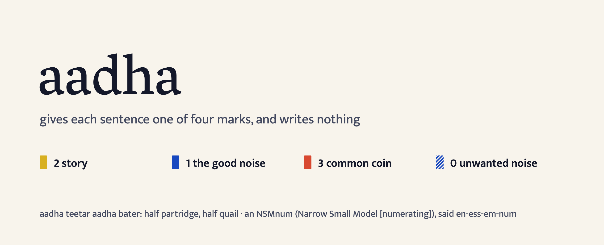
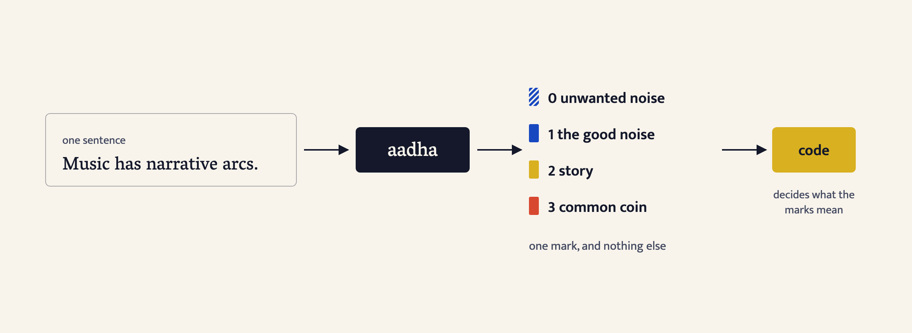
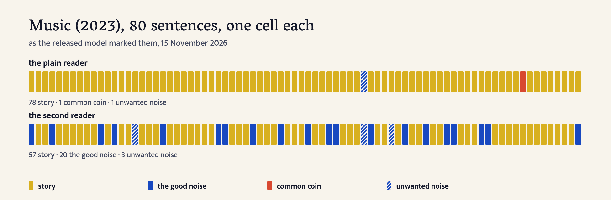
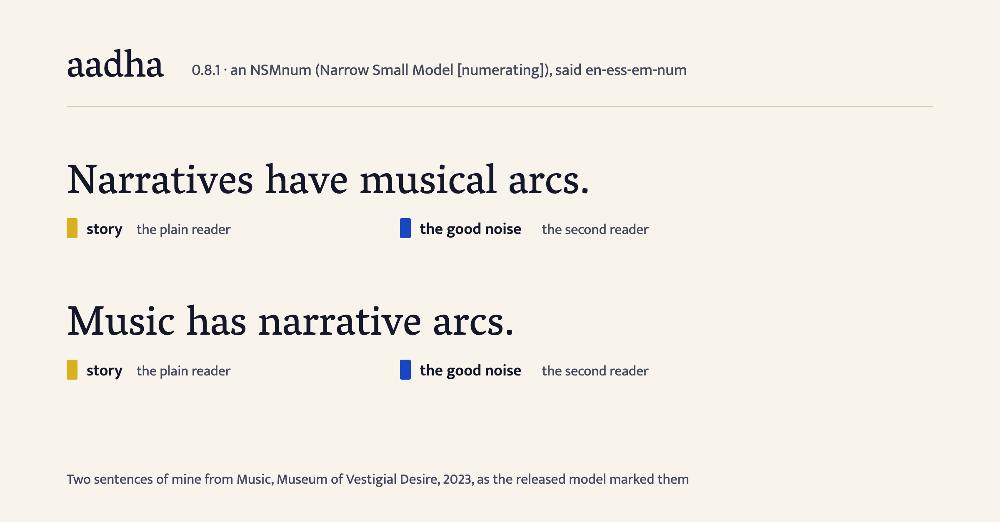
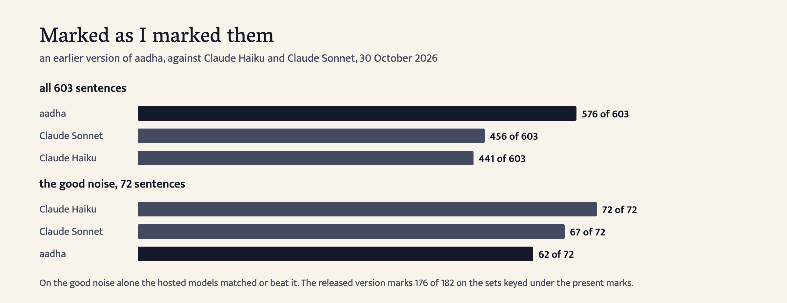

# aadha

<p align="center"></p>

<p align="center">
<a href="https://github.com/syntax-context/aadha/releases/latest"></a>
<a href="https://huggingface.co/prayasabhinav/aadha"></a>
<a href="https://syntax.prayasabhinav.net/nsmnum/"></a>
<a href="#what-it-was-measured-to-do"></a>
<a href="#how-it-reads-a-page"></a>
<a href="https://huggingface.co/microsoft/MiniLM-L12-H384-uncased"></a>
<a href="https://ungli.syntax.prayasabhinav.net/#aadha"></a>
<a href="LICENSE"></a>
<a href="#licences"></a>
</p>

A small reader that gives each sentence one mark:

| mark | means |
|---|---|
| 0 | unwanted noise |
| 1 | the good noise |
| 2 | story |
| 3 | common coin |

*The good noise* is writing with more than the usual amount of abstraction, layered meaning or analogy, where it says something a reader could argue with. *Common coin* is a pairing already in circulation, a saying or a stock phrase. *Story* is plain meaning. *Unwanted noise* is writing that holds no ground: decoration, nonsense, or a figure that fits anything.

aadha only marks. It writes nothing. Code, not the model, decides what the marks mean for a piece of writing. In *teetar aadhi bater*, the tool built on it, the page shows how the marks are spread across the piece. Its name is from the Hindi idiom *aadha teetar aadha bater*, half partridge, half quail: a thing that is neither one thing nor the other.

It is an NSMnum (Narrow Small Model [numerating], said en-ess-em-num, एन-एस-एम-नम; written NSM until 15 November 2026, when the short form was changed to avoid a collision with the Natural Semantic Metalanguage in linguistics). What is narrow is its answer, which is always one of four marks; the model's own size does not decide it. It is an exemplar in [ungli](https://ungli.syntax.prayasabhinav.net), the builder for NSMnum, and part of [SYNTAX](https://syntax.prayasabhinav.net).

<p align="center"></p>

## Use it

The weights are on Hugging Face at [prayasabhinav/aadha](https://huggingface.co/prayasabhinav/aadha).

```
pip install torch transformers peft
python use.py "The bus was late again." "Every mistake leaves a fingerprint on the next one."
python use.py --reflect "..."
```

`--reflect` loads the *reflect* adapter, a second reader trained on top of the first for argued or reflective pieces. Nothing chooses between the two for you: the person using the tool chooses.

## How it reads a page

Every sentence of my Museum of Vestigial Desire page *Music* (2023), one sentence per cell, as the released model marked them on 15 November 2026:

<p align="center"></p>

Two sentences from the page, as the plain reader and the second reader marked them:

<p align="center"></p>

## How it is made

`microsoft/MiniLM-L12-H384-uncased` with a new four-way head, trained three passes at 5e-5, batch 16, on three seeds whose weights are averaged into one ("souped"). Sentences are read up to 96 tokens. The rows are made by the scripts in `scripts/` (`gen.py` and the row builders beside it), and `train.py` trains an arm. The reflect adapter is a LoRA adapter trained with `adapter.py`.

The version released here is the one last served, *o4x3* with the *reflect* adapter, live from 3 November 2026 until the reader was taken offline on 9 November 2026. Its training labels are Claude's reading of the rows, which I agreed to use; they are not my keys. Every test it was measured on I keyed myself, before it was trained. The training rows themselves are not released.

## What it was measured to do

| | result | tested on |
|---|---|---|
| all sentences | 576 of 603 marked as I marked them (Haiku 441, Sonnet 456) | 603 sentences I marked before any model saw them, 30 October 2026; an earlier version, not the one released here |
| the good noise | 62 of 72 found (Haiku 72, Sonnet 67) | the same 603 sentences, the same earlier version |
| present marks | 176 of 182 right | sets I keyed under the present marks, 3 November 2026; the version released here |

Hosted models matched or beat aadha on the good noise. Its whole lead over them was on one boundary, abstract nonsense, which they called the good noise. Two trainings of the same setup, each averaged over three seeds, disagree on 13 to 16 sentences of the large test sets, so a difference smaller than that means nothing. Two things are not solved: common coin in fresh wording (0 of 6, for every version), and misspelt story, which can read as unwanted noise.

<p align="center"></p>

## Licences

The code is under the GNU Affero General Public License 3.0 (`LICENSE`). This text and the model card are under CC BY 4.0. The weights are under CC BY 4.0. By Prayas Abhinav.
